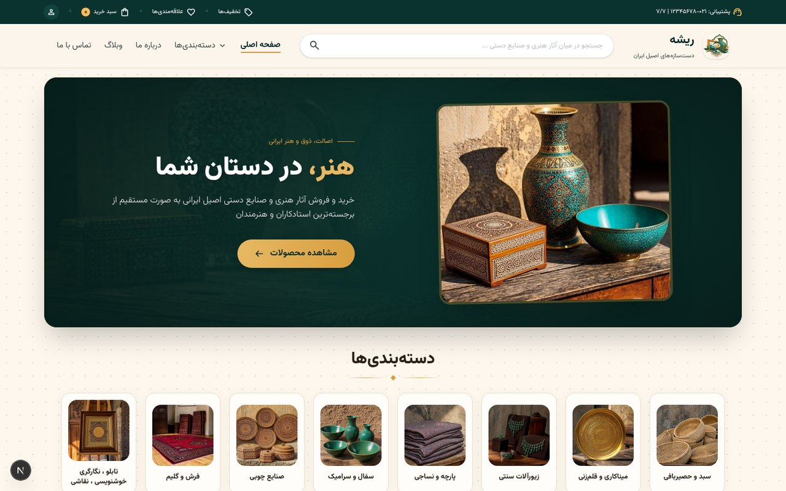
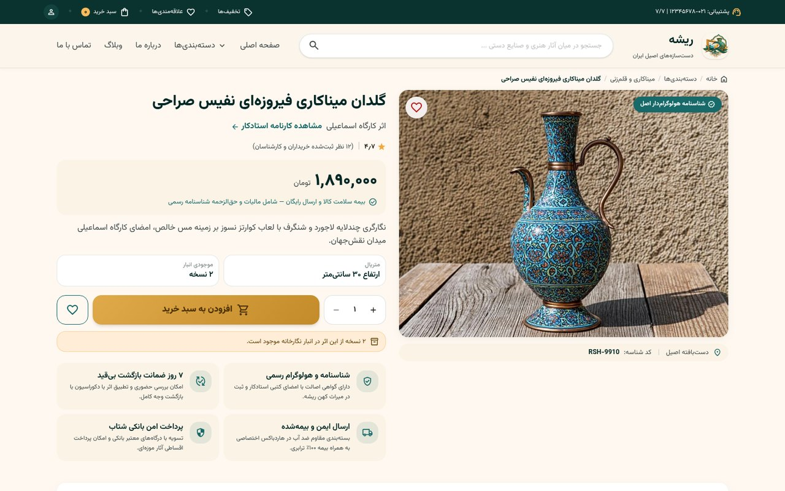
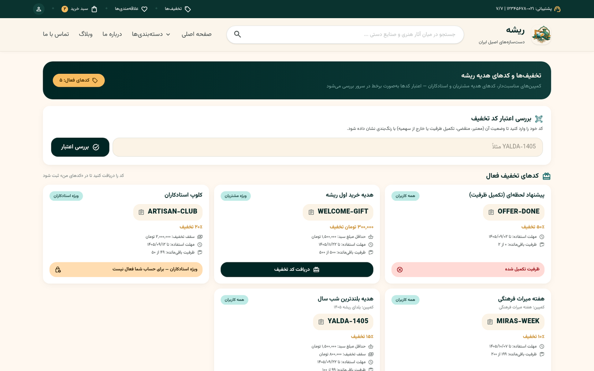
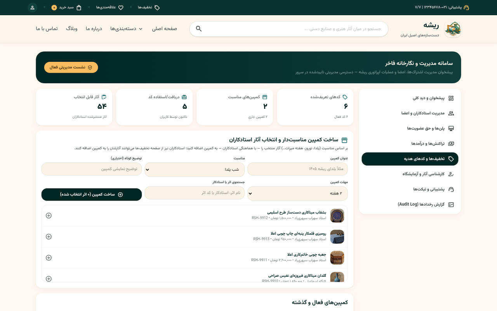
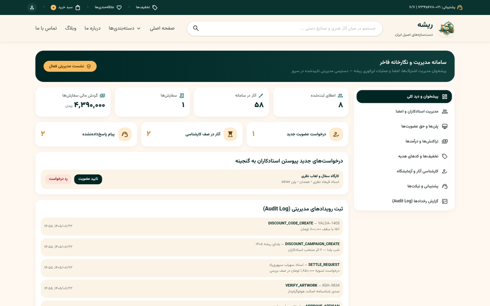
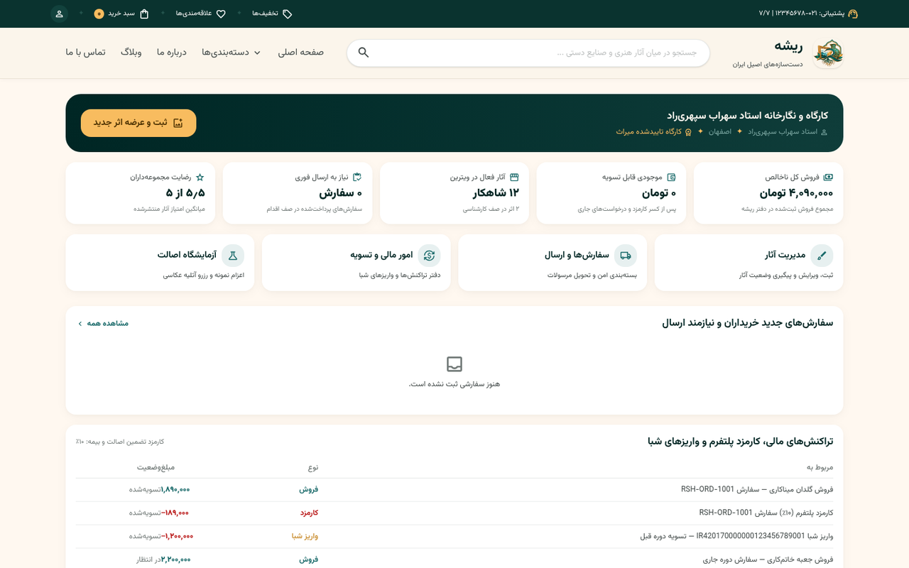

<div align="center">


# ریشه | Risheh

**بازار آنلاین هنر و صنایع‌دستی اصیل ایران**

فروشگاه کامل، شناسنامه اصالت هولوگرام‌دار، آزمایشگاه اصالت آثار و سامانه مدیریت تخفیف‌های مناسبتی — با تجربه‌کاربری کاملاً فارسی و راست‌به‌چپ

[Next.js 16](https://nextjs.org/) · [TypeScript](https://www.typescriptlang.org/) · [Tailwind CSS 4](https://tailwindcss.com/) · [shadcn/ui](https://ui.shadcn.com/) · [Prisma 6](https://www.prisma.io/) · PostgreSQL (Neon) · Vercel · Docker · PWA


-00695C)



**[امکانات](#امکانات-کلیدی) · [اجرا از صفر تا صد](#اجرا-از-صفر-تا-صد) · [حساب‌های نمایشی](#حسابهای-نمایشی) · [معماری](#پشته-فناوری-و-معماری) · [عیب‌یابی](#عیبیابیهای-رایج)**

</div>

---

## ریشه چیست؟

**ریشه** یک بازار آنلاین برای کشف، خرید، فروش و احراز اصالتِ هنر و صنایع‌دستی ایرانی است. استادکاران کارگاه‌های خود را ثبت می‌کنند و آثار دست‌سازشان (قالی، میناکاری، خاتم، سفال، ترمه، زیورآلات و…) را با روایت و شناسنامه عرضه می‌کنند؛ مشتریان با اطمینان از اصالت خرید می‌کنند؛ و تیم عملیات همه چیز را از یک پیشخوان واحد مدیریت می‌کند.

سه نقش در سیستم زندگی می‌کنند:

| نقش | چه می‌کند؟ |
| --- | --- |
| **مشتری** | جست‌وجو و کشف آثار، سبد خرید و پرداخت، پیگیری سفارش، دریافت کدهای تخفیف و استعلام اصالت |
| **استادکار** | مدیریت آثار و نمایشگاه شخصی، ارسال به آزمایشگاه اصالت، امور مالی و درخواست تسویه، استفاده از کدهای ویژه استادکاران |
| **مدیر** | تأیید عضویت استادکاران، کارشناسی آثار و صف آزمایشگاه، ساخت کمپین‌های تخفیف مناسبتی و کدهای هدیه، تراکنش‌ها، پشتیبانی و گزارش رخدادها |

> **وضعیت: نسخه نمایشی (دمو).** پرداخت، پیامک و تسویه بانکی «شبیه‌سازی‌شده» هستند و در رابط کاربری هم با برچسب «نمایشی» مشخص شده‌اند. پول واقعی جابه‌جا نمی‌شود.

---

## نگاهی به بخش‌های مهم

| | |
| --- | --- |
|  |  |
| **صفحه محصول** — گالری، جنس و ابعاد، سایز و رنگ، نظرات و شناسنامه اصالت | **تخفیف‌ها و کدهای هدیه (نمای مشتری)** — کدهای فعال، دریافت کد و بررسی اعتبار آنی |
|  |  |
| **سامانه مدیریت تخفیف (ادمین)** — ساخت کمپین مناسبتی با انتخاب آثار استادکاران + پنل کدها | **پیشخوان مدیریت** — آمار کلی، درخواست‌های عضویت و ثبت رخدادها (Audit Log) |
|  | |
| **کارگاه و نگارخانه استادکار** — فروش، اموال، سفارش‌ها، تسویه و آزمایشگاه در یک نگاه | |

---

## امکانات کلیدی

### فروشگاه و خرید (مشتری)

- صفحه اصلی با دسته‌بندی‌ها، آثار منتخب و جست‌وجو
- کشف آثار با فیلتر، مرتب‌سازی و صفحه‌بندی در ۸ دسته (فرش، میناکاری، سفال، خاتم، ترمه، زیورآلات، حصیربافی، خوشنویسی)
- صفحه محصول با گالری تصاویر، روایت اثر، سایز/رنگ، مشخصات، نظرات و شناسنامه اصالت
- سبد خرید سمتِ سرور (مهمان یا واردشده) با ورژن‌بندی سایز و رنگ
- تسویه‌حساب با روش‌های ارسال دارای قیمت واقعی متفاوت؛ جمع کل و موجودی **سمت سرور** بازمحاسبه می‌شود
- درگاه پرداخت نمایشی با مسیرهای موفقیت / شکست / انصراف (با برچسب شفاف «شبیه‌سازی»)
- تاریخچه سفارش + تایم‌لاین پیگیری مرسوله

### تخفیف‌ها و کدهای هدیه (جدید)

- **ساخت کمپین مناسبتی** توسط ادمین (یلدا، نوروز، هفته میراث فرهنگی و…) با انتخاب آثارِ منتخب — حتی با مشارکت مستقیم خود استادکاران
- **پنل مدیریت چندین کد تخفیف**: درصدی یا مبلغ ثابت، با سقف تخفیف، حداقل سبد خرید، محدودیت مخاطب (همه / مشتری / استادکار)، سهمیه کل و سهمیه هر کاربر و تاریخ انقضا
- **صفحه اختصاصی تخفیف‌ها برای مشتری و استادکار**: دیدن کدهای فعال، دریافت (Claim) کد و مشاهده کدهای خودشان
- **بخش بررسی اعتبار کد**: هر کاربر می‌تواند هر لحظه ببیند کدش معتبر است یا نه، قابل استفاده است یا نه (منقضی / تکمیل ظرفیت / قبلاً استفاده شده)
- ثبت همه رخدادهای تخفیف در Audit Log

### اصالت و آزمایشگاه

- صدور شناسنامه اصالت با کد هولوگرام یکتا (مثل `RSH-9834-HOLO`)
- جریان کاری آزمایشگاه (صف کارشناسی، در حال آزمایش، صدور) توسط ادمین
- استعلام عمومی اصالت با کد هولوگرام یا کد اثر — سه حالت «تأییدشده / در انتظار / یافت نشد»

### استادکار

- ثبت و ویرایش آثار با وضعیت‌های انتشار (پیش‌نویس → در صف بررسی → منتشرشده)
- کتابخانه تصاویر منتخب، درخواست آزمایشگاه، دفتر مالی و درخواست تسویه
- کدهای تخفیف ویژه اعضای استادکار

### مدیر

- تأیید/رد عضویت استادکاران و پلن‌های عضویت (برنزی تا ملی)
- تراکنش‌ها، تسویه‌ها، پشتیبانی و پیام‌ها، گزارش کامل رخدادها
- مدیریت کامل تخفیف‌ها و کدهای هدیه

### مشترک

- احراز هویت نمایشی با هش scrypt و کوکی نشست `httpOnly`
- **PWA قابل نصب** روی موبایل با صفحه آفلاین و Service Worker
- رابط کاربری کاملاً فارسی و راست‌به‌چپ با فونت وزیرمتن و زبان طراحی «میراث لوکس ایرانی»

---

## اجرا از صفر تا صد

### پیش‌نیازها

| راه | پیش‌نیاز |
| --- | --- |
| داکر (پیشنهادی) | فقط [Docker Desktop](https://www.docker.com/products/docker-desktop/) |
| اجرای محلی | Node.js 20+ یا [Bun](https://bun.sh/) |

### راه اول — با داکر (ساده‌ترین، توصیه‌شده)

```bash
# ۱) کلون پروژه
git clone https://github.com/<USERNAME>/risheh.git
cd risheh

# ۲) ساخت و اجرا — همین!
docker compose up -d --build
```

باز کنید: **http://localhost:3000** — همینطور!

ایمیج داکر به‌صورت خودکار دیتابیس دموی seed شده (۸ کاربر، ۵۸ اثر، کدهای تخفیف و…) را داخل خودش می‌سازد؛ در اولین اجرا به volume منتقل می‌شود و داده‌های شما ماندگار می‌مانند. سلامت سرویس از طریق healthcheck روی `/api/health` کنترل می‌شود.

**بازنشانی کارخانه‌ای** (پاک کردن داده‌ها و برگرداندن دیتابیس دموی تازه):

```bash
docker compose down -v
docker compose up -d --build
```

### راه دوم — اجرای محلی (بدون داکر)

```bash
# ۱) کلون و نصب وابستگی‌ها
git clone https://github.com/<USERNAME>/risheh.git
cd risheh
bun install                # یا: npm install

# ۲) فایل محیط
cp .env.example .env       # ویندوز: copy .env.example .env

# ۳) ساخت دیتابیس و داده دمو
bun run db:push            # یا: npm run db:push
bun prisma/seed.ts         # داده‌های نمایشی (حساب‌ها، آثار، کدهای تخفیف…)

# ۴) اجرا
bun run dev                # یا: npm run dev
```

باز کنید: **http://localhost:3000**

> نسخه تولید: `bun run build && bun run start`

### حساب‌های نمایشی

رمز عبور همه حساب‌ها: **`risheh1403`**

| نقش | رایانامه |
| --- | --- |
| مشتری | `buyer@risheh.ir` |
| استادکار | `artisan@risheh.ir` |
| مدیر | `admin@risheh.ir` |

این اطلاعات دمو در صفحه ورود هم نمایش داده می‌شود و فقط برای نسخه نمایشی است.

### کدهای تخفیف دمو

بعد از seed شدن، این کدها را در بخش «تخفیف‌ها» امتحان کنید:

| کد | مقدار | شرح |
| --- | --- | --- |
| `YALDA-1405` | ۱۵٪ (سقف ۸۰۰٬۰۰۰ تومان) | کمپین یلدای ریشه — حداقل سبد ۱٬۵۰۰٬۰۰۰ تومان |
| `MIRAS-WEEK` | ۱۰٪ | هفته میراث فرهنگی |
| `WELCOME-GIFT` | ۳۰۰٬۰۰۰ تومان ثابت | هدیه اولین خرید مشتری |
| `ARTISAN-CLUB` | ۲۰٪ | ویژه استادکاران |
| `NOWRUZ-LAST` | ۱۲٪ | نمونه کد **منقضی‌شده** برای تست بررسی اعتبار |
| `OFFER-DONE` | ۵۰٪ | نمونه کد **تکمیل ظرفیت** |

### تور پیشنهادی ۵ دقیقه‌ای بعد از اجرا

1. صفحه اصلی را ببینید و وارد یک دسته‌بندی شوید؛ یک محصول را باز کنید و «افزودن به سبد خرید» را بزنید.
2. با حساب مشتری وارد شوید → از منوی بالا «تخفیف‌ها» را باز کنید → کد `WELCOME-GIFT` را **دریافت** کنید.
3. کد `NOWRUZ-LAST` را در کادر «بررسی اعتبار کد تخفیف» امتحان کنید تا حالت «منقضی‌شده» را ببینید.
4. از حساب مشتری خارج شوید و با حساب **مدیر** وارد شوید → پیشخوان مدیریت → بخش **«تخفیف‌ها و کدهای هدیه»** → یک کمپین مناسبتی بسازید و آثار استادکاران را در آن انتخاب کنید.
5. با حساب **استادکار** وارد شوید → کارگاه و نگارخانه شما با فروش، اموال، سفارش‌ها و درخواست تسویه.

---

## پشته فناوری و معماری

| لایه | انتخاب |
| --- | --- |
| فریم‌ورک | Next.js 16 (App Router)، TypeScript strict |
| رابط کاربری | Tailwind CSS 4 + shadcn/ui، آیکون‌های Material Symbols، فونت وزیرمتن (self-hosted) |
| داده | Prisma ORM + PostgreSQL (Neon) با ۲۵ مدل — مهاجرت‌شده از SQLite |
| حالت | Server Components + Server Actions (بدون کتابخانه state سمت کلاینت) |
| احراز هویت | آداپتور دمو — هش scrypt، کوکی نشست `httpOnly`، ذخیره نشست سمت سرور |
| مسیریابی | تک‌صفحه (`/`) با روتر hash داخلی (`#/home`، `#/product/<id>`، `#/admin`، …) |

**سه اصل غیرقابل‌مذاکره در کد رعایت شده:** طراحی از آرشیو اصلی «Persian Luxury Heritage» حفظ شده؛ هیچ رفتار جعلی بدون برچسب «نمایشی» وجود ندارد؛ و مجوزدهی (نقش و مالکیت) همیشه در Server Actions سمت سرور انجام می‌شود — به مقادیر سمت کلاینت اعتماد نمی‌شود. جمع کل سفارش‌ها هم همیشه سمت سرور بازمحاسبه می‌شود.

---

## ساختار پروژه

```
src/
├── app/            # layout.tsx (fa/RTL)، page.tsx (داده سمت سرور)، globals.css (توکن‌های طراحی)
├── components/
│   ├── layout/     # SiteHeader، SiteFooter
│   ├── storefront/ # ProductCard، RatingStars، StatusPill، SectionHeader
│   └── icons.tsx   # wrapper آیکون‌های Material Symbols
├── lib/
│   ├── actions/    # Server Actions: auth، cart، orders، artworks، admin، discounts…
│   ├── data.ts     # loadAppData() — تمام داده سمت سرور پوسته SPA
│   ├── fa.ts       # اعداد و تاریخ فارسی، برچسب وضعیت‌ها
│   ├── session.ts  # آداپتور احراز هویت دمو
│   └── db.ts       # کلاینت Prisma
└── risheh/
    ├── RishehApp.tsx      # پوسته SPA (هدر/فوتر + سوییچ نما)
    ├── router.ts          # روتر hash
    └── views/             # home، categories، product، cart، payment، verify، login،
                           # about، blog، contact، dashboard، artworks، orders، finance،
                           # lab، admin (+ بخش discounts)، discounts، favorites
prisma/
├── schema.prisma  # ۲۵ مدل (شامل DiscountCampaign/Code/Redemption/Artwork)
└── seed.ts        # داده دمو — ۸ کاربر، ۵۸ اثر، ۸ دسته، کمپین‌ها و کدهای تخفیف
docs/              # مستندات معماری، طراحی، داده، امنیت، استقرار + اسکرین‌شات‌ها
public/assets/     # تصاویر منتخب + فونت‌های وزیرمتن و Material Symbols
```

## نقشه مستندات

| سند | موضوع |
| --- | --- |
| `CLAUDE.md` | نقطه شروع هر جلسه ادامه کار |
| `docs/ARCHITECTURE.md` | معماری، ساختار، جریان داده و تصمیم مسیریابی |
| `docs/DESIGN_SYSTEM.md` | توکن‌های بصری حفظ‌شده و قواعد طراحی |
| `docs/DATA_MODEL.md` | اسکیمای Prisma و روابط |
| `docs/SECURITY.md` | احراز هویت، مجوزدهی، اعتبارسنجی و مرزهای دمو |
| `docs/TESTING.md` | چه چیزهایی تأیید شده و چه چیزهایی پوشش داده نشده |
| `docs/DEPLOYMENT.md` | متغیرهای محیط، پیکربندی سرویس‌دهنده‌ها |
| `docs/DEPLOY-POSTGRES-FA.md` | **استقرار Vercel + Neon PostgreSQL — مهاجرت داده، کارایی و عیب‌یابی** |
| `docs/DECISIONS.md` | تصمیم‌های فنی/محصولی و دلیلشان |
| `docs/PROGRESS.md` · `docs/HANDOFF.md` · `docs/CHANGELOG.md` | وضعیت فازها و ادامه کار |
| `docs/screenshots/` | اسکرین‌شات‌های همین README |

---

## عیب‌یابی‌های رایج

**خطای `P2021: The table ... does not exist in the current database`**
وقتی ایمیج را با کد جدید rebuild می‌کنید ولی volume دیتابیس هنوز نسخه قدیمی را نگه داشته، این خطا رخ می‌دهد. راه‌حل:

```bash
docker compose down -v && docker compose up -d --build
```

(این کار دیتابیس را به دموی تازه برمی‌گرداند. اگر داده‌هایتان را نمی‌خواهید از دست بدهید، جدول‌های جاافتاده را با `prisma db push` به همان فایل اضافه کنید.)

**پورت ۳۰۰۰ اشغال است**
`PORT=3100 docker compose up -d` یا `PORT=3100 npm run dev`

**در اجرای محلی خطای اتصال دیتابیس می‌گیرم**
مطمئن شوید `cp .env.example .env` را انجام داده‌اید و قبل از `dev`، دستورهای `db:push` و `seed` را اجرا کرده‌اید.

**بعد از تغییر `prisma/schema.prisma`**
`bun run db:push` را اجرا کنید (و در صورت نیاز دوباره seed بزنید).

---

## یادداشت دمو

این پروژه یک **نسخه نمایشی/توسعه‌ای** است: پرداخت، پیامک/OTP، رایانامه و تسویه بانکی شبیه‌سازی شده‌اند و در رابط کاربری با برچسب‌های شفاف («نمایشی»، «شبیه‌سازی — پول واقعی جابه‌جا نمی‌شود») مشخص شده‌اند. هیچ درگاه بانکی، سرویس ارسال یا احراز هویت واقعی پیکربندی نشده است. جزئیات کامل در `docs/SECURITY.md` و `docs/DEPLOYMENT.md`.
